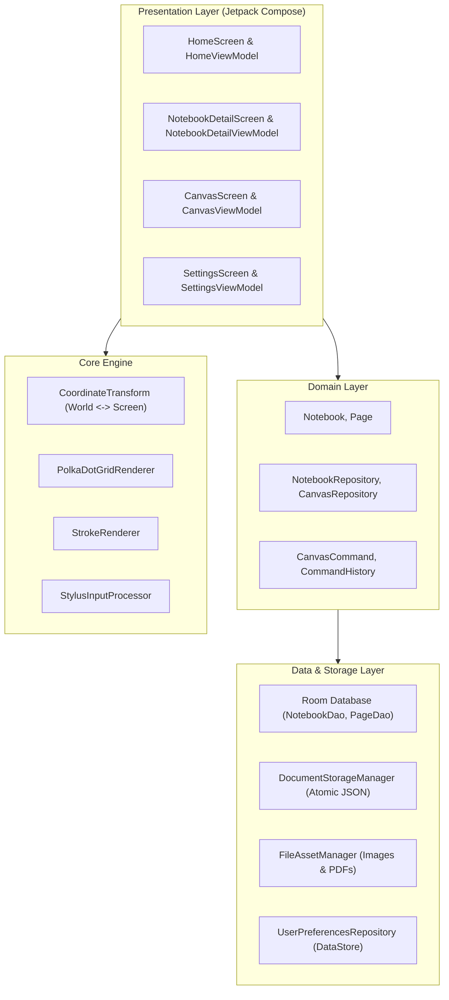
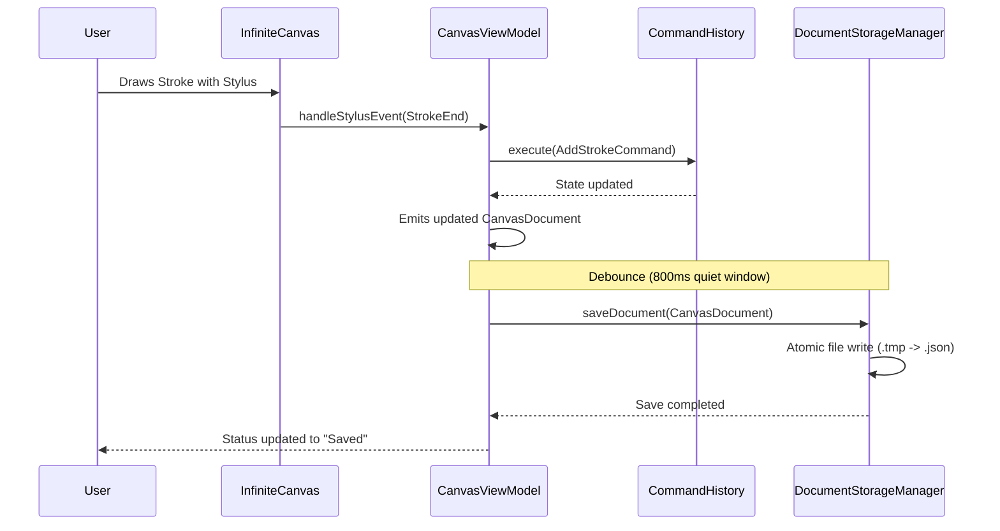

# Canvotes — Architectural Specification

## 1. Architectural Principles

Canvotes is engineered following **Clean Architecture**, **Model-View-ViewModel (MVVM)**, and **Unidirectional Data Flow (UDF)**. The core canvas rendering and interaction engine is strictly decoupled from the UI framework and persistence layer.

---

## 2. Layer Breakdown

### A. Presentation Layer (`com.canvotes.feature.*`, `com.canvotes.design.*`)
* **Jetpack Compose Single-Activity Architecture**: Driven by `MainActivity` and `CanvotesNavHost`.
* **State Management**: ViewModels expose immutable `StateFlow<T>` streams to Composables, ensuring recomposition is surgical and localized.
* **Canvas Composable**: `InfiniteCanvas` delegates raw motion events to `StylusInputProcessor` and procedural graphics to `PolkaDotGridRenderer` and `StrokeRenderer`.

### B. Core Canvas Engine (`com.canvotes.core.*`)
* **World vs. Screen Coordinates**:
  All persistent drawing primitives (Strokes, Shapes, Textboxes, Images) are stored in continuous **world coordinates** $(\text{worldX}, \text{worldY})$.
  $$\text{screenX} = (\text{worldX} + \text{panX}) \times \text{zoom}$$
  $$\text{screenY} = (\text{worldY} + \text{panY}) \times \text{zoom}$$
  $$\text{worldX} = \frac{\text{screenX}}{\text{zoom}} - \text{panX}$$
  $$\text{worldY} = \frac{\text{screenY}}{\text{zoom}} - \text{panY}$$
* **Low-Latency Input Processing**:
  `StylusInputProcessor` extracts historical batch samples from `MotionEvent.getHistoricalX()` and `MotionEvent.getHistoricalPressure()` to prevent segmented corners during rapid stroke execution.
* **Jitter Filter & Bezier Smoothing**:
  `BezierSmoother` filters sub-pixel jitter (< 1.5 px) and synthesizes quadratic Bezier curves using mid-point tangent interpolation.

### C. Domain Layer (`com.canvotes.domain.*`)
* Defines pure business models (`Notebook`, `Page`) and repository interfaces.
* Completely free of Android SDK framework dependencies.
* Implements the **Command Pattern** (`CanvasCommand`, `CommandHistory`) for deep, lossless Undo/Redo state transitions.

### D. Data & Persistence Layer (`com.canvotes.data.*`)
* **Relational Storage (Room Database)**:
  * Manages `notebooks` table and `pages` table with foreign key cascade deletion.
  * Fast indexing for search queries, page counts, and modification order.
* **Document State Storage (`DocumentStorageManager`)**:
  * Serializes `CanvasDocument` to JSON using `kotlinx.serialization.json`.
  * Writes to temporary swap files (`.tmp`) followed by atomic filesystem rename (`renameTo()`) to guarantee zero corruption if interrupted by an OS process kill.
* **Binary Media Storage (`FileAssetManager`)**:
  * Saves imported images and PDFs into sandboxed internal storage (`files/assets/`).
  * Never serializes binary blobs into SQLite tables.
* **Preferences Storage (`UserPreferencesRepository`)**:
  * Uses Jetpack DataStore Preferences for reactive persistence of theme mode, default tool, stroke thickness, and palm rejection toggles.

---

## 3. Data Flow & Auto-Save Lifecycle

---

## 4. Security & Privacy
* **100% Local-First**: Notes, sketches, images, and documents never leave the local device.
* **Sandboxed Storage**: All documents and assets reside strictly inside `context.filesDir`.
* **Zero Telemetry**: No third-party analytics or background trackers.
