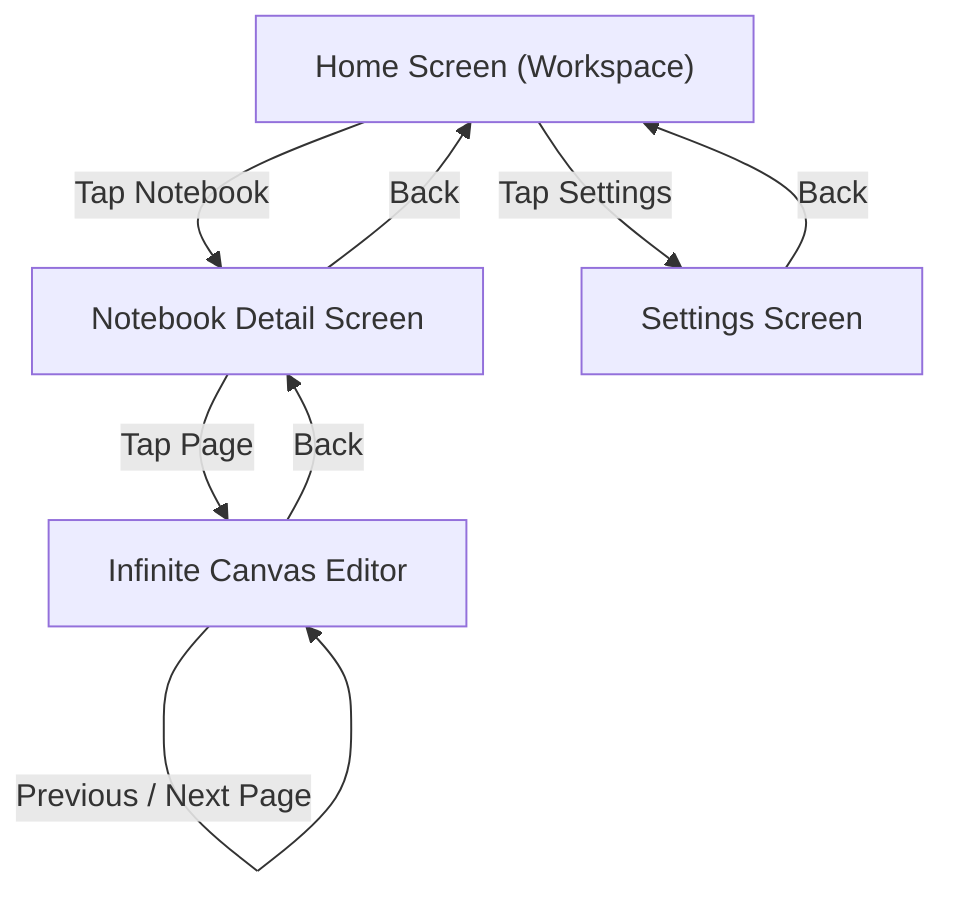

# Canvotes — Product & Game Design Document (GDD)

## 1. Product Vision & Philosophy

**Product Name:** Canvotes  
**Platform:** Native Android (Jetpack Compose, Kotlin)  
**Target Audience:** Writers, thinkers, researchers, designers, mathematicians, and visual organizers who demand a distraction-free digital paper experience.  

### Core Philosophy
> *"An infinite space for finite distractions."*

Traditional digital note-taking apps suffer from tool clutter, colorful UI chrome, and artificial page boundaries. Canvotes eliminates arbitrary constraints by offering an expansive infinite canvas paired with an uncompromising monochromatic design system.

---

## 2. Visual Design System

### A. Monochromatic Aesthetic
The visual presentation is strictly monochromatic to prevent UI elements from competing with user cognition.

| Token | Hex (Light Mode) | Hex (Dark Mode) | Purpose |
|---|---|---|---|
| `Primary` | `#000000` | `#FFFFFF` | Primary text, primary actions, active tool selection |
| `OnPrimary` | `#FFFFFF` | `#000000` | Contrasting content on primary surfaces |
| `Background` | `#FFFFFF` | `#09090B` | Root application background |
| `Surface` | `#FAFAFA` | `#18181B` | Card containers, dialog backgrounds, toolbar background |
| `SurfaceVariant` | `#F4F4F5` | `#27272A` | Secondary chip backgrounds, preview borders |
| `Outline` | `#D4D4D8` | `#3F3F46` | Subtle dividers, inactive stroke boundaries |
| `OutlineVariant` | `#E4E4E7` | `#27272A` | Ultra-low contrast structural borders |
| `CanvasBg` | `#FFFFFF` | `#121212` | Drawing canvas backdrop |
| `DotColor` | `#D4D4D8` | `#27272A` | Dynamic polka-dot grid points |

### B. Polka-Dot Grid Mathematics
The canvas background is not a static bitmap. It is procedurally drawn on every frame to ensure infinite panning and crisp rendering at all scale factors.

1. **Base Spacing ($D_{base}$):** $36\text{ dp}$ in world coordinate space.
2. **Subsampling Algorithm:**
   * When $\text{zoom} < 0.25$: Step multiplier = 4 (spacing = $144\text{ dp}$)
   * When $0.25 \le \text{zoom} < 0.50$: Step multiplier = 2 (spacing = $72\text{ dp}$)
   * When $\text{zoom} \ge 0.50$: Step multiplier = 1 (spacing = $36\text{ dp}$)
3. **Dot Radius Scaling:**
   $$r_{dot} = \text{clamp}\left(1.4 \times \sqrt{\text{clamp}(\text{zoom}, 0.4, 2.5)}, 1.0, 3.5\right)\text{ px}$$
4. **Distance & Alpha Attenuation:**
   When $\text{zoom} < 0.15$, dot alpha attenuates gracefully to prevent moiré patterns and visual vibration.

---

## 3. Input Model & Interaction Mechanics

### A. Pointer Input Rules
1. **Stylus Detection:** Android `MotionEvent.TOOL_TYPE_STYLUS` or `TOOL_TYPE_ERASER`.
   * Stylus touches always initiate vector ink creation or vector stroke erasure.
   * Stylus pressure ($0.1$ to $1.0$) dynamically modulates the instantaneous stroke width.
2. **Finger Touch Detection:** Android `MotionEvent.TOOL_TYPE_FINGER`.
   * Single finger pans the canvas viewport by default.
   * If the user enables *"Draw with Finger"* in Settings, single finger draws strokes.
3. **Two-Finger Gestures:**
   * Two simultaneous fingers always perform viewport panning and pinch-to-zoom, regardless of tool mode.
4. **Palm Rejection Heuristic:**
   * Contact geometry inspection: If `touchMajor > 120f` or (`touchMajor > 80f` and `touchMinor > 60f`), the touch is identified as a wrist/palm rest and immediately discarded.
   * Active stylus arbitration: When a stylus down event is active, all simultaneous finger pointers are locked out.

### B. Handwriting Tools
* **Pen:** Solid vector stroke with round caps and joins. Responsive to pressure.
* **Pencil:** Textured graphite appearance ($75\%$ opacity, narrower stroke, subtle attenuation).
* **Highlighter:** Wide translucent tint ($32\%$ opacity, square caps, $3.5\times$ base thickness).
* **Eraser:** Collision-based vector stroke removal. Erases the entire stroke intersecting the eraser radius.

---

## 4. Canvas Objects & Overlays

1. **Textboxes:**
   * Inserted at the current viewport center.
   * Supports inline markdown-inspired formatting (Bold toggle, Italic toggle).
   * Free dragging across world coordinate space.
2. **Vector Shapes:**
   * Supports Rectangles, Rounded Rectangles, Circles, Ellipses, Straight Lines, and Directional Arrows.
   * Real-time preview during drag gestures.
3. **Images:**
   * Imported via Android Storage Access Framework / Photo Picker.
   * Scaled in world coordinates with aspect ratio preservation and corner resize handles.
4. **PDF Annotation:**
   * Multi-page PDF documents rendered into canvas coordinates with independent overlay drawing layers.

---

## 5. Screen Hierarchy & UX Flow

### Home Screen
* Minimalist header displaying Canvotes branding and tagline.
* Responsive search field filtering notebooks by title and description.
* Grid of notebook cards displaying page counts, updated timestamps, and options menu (Rename, Delete).
* Floating Action Button to create a new notebook.

### Notebook Detail Screen
* Header displaying notebook title and total page counter.
* Grid of page thumbnails showing page title, page number, and actions (Rename, Duplicate, Delete).
* Floating Action Button to append a new page and jump directly into editing.

### Canvas Editor Screen
* Maximum screen real-estate allocated to the infinite canvas.
* Floating top toolbar with tool picker, thickness slider, shape picker, image/pdf import, and undo/redo buttons.
* Floating bottom status bar displaying page indicator (`Page X / Y`), quick navigation buttons, and auto-save indicator (`Saved` / `Saving...`).
